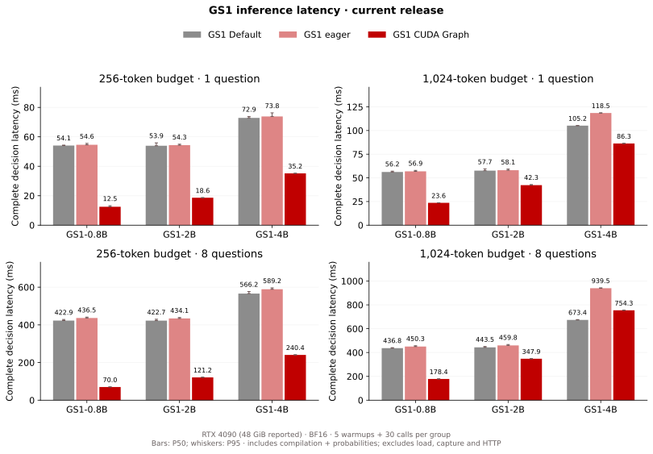

# GS1 — General System One

[English](README.md) · [简体中文](README.zh-CN.md)


> ***Fast, Faithful, Frontier System One Intelligence.***

GS1 is a family of fast, uncertainty-aware, open-source decision models developed by **BIGAI** (Beijing Institute for General Artificial Intelligence). It computes native probability distributions over variable candidate sets for agent routing, verification, extraction, and control.

[Models](https://huggingface.co/collections/bigai/gs1) · [Playground](playground/README.md) · [Documentation](docs/README.md) · [Technical Report]()

## Highlights

- **A decision head that retrieves evidence.** Native multi-head cross-attention queries state evidence for runtime-defined candidates. With context and input representations fixed, head-level probabilities remain identical after a candidate permutation is undone. [Architecture](docs/model.md#backbone-and-evidence-retrieval)
- **Full comparisons, reusable prefixes.** Causal Gated DeltaNet and segmented bidirectional full attention give candidates their complete comparison context while preserving immutable prefixes for reuse across questions. Carry-preserving **AttnRes** lets sparse full-attention receivers query earlier representations while retaining the explicit skip-connection anchor.
- **Fast — native decisions, zero decoding.** One joint distribution directly yields **Choice** candidate probabilities, **Noul** true/false verification and **Score** expected ordinal values. With CUDA Graph, GS1-0.8B reaches **12.51 ms P50** for one short question and **6.05×** speedup over GS1 Default inference for eight short questions. [Measurements](benchmark/latency.md)
- **Faithful — learn the probability used to act.** CRPO optimizes the sampled action's actual probability with a Brier reward. Native distributions and confidence expose uncertainty so applications can defer a decision, seek evidence or select an explicit abstention option. [Probability and confidence](docs/api.md#confidence)
- **Frontier — compact models, competitive quality.** GS1-4B scores **68.97** in the latest public text evaluation, **8.27 points above Jev 1.14**. All four GS1 scales sit on the displayed parameter–performance frontier. [Results](#models-and-results)

## Models and results

| Model | Decision Index (Public index) | Weights |
|---|---:|---|
| **GS1-0.8B** | **56.12** | [Hugging Face](https://huggingface.co/bigai/GS1-0.8B) |
| **GS1-2B** | **62.22** | [Hugging Face](https://huggingface.co/bigai/GS1-2B) |
| **GS1-4B** | **68.97** | [Hugging Face](https://huggingface.co/bigai/GS1-4B) |
| **GS1-9B** | **70.45** | [Hugging Face](https://huggingface.co/bigai/GS1-9B) |

Exact stored counts and source identities are in [the results](benchmark/results.md).

These are the **latest complete public-suite results** (edition 0.3). All four models have **100% coverage** across **43 text benchmarks**, including **37 benchmarks** that contribute to the Public index. [Evaluation details](benchmark/results.md).


Full-split measurements:

| Benchmark | Decisions | GS1-0.8B | GS1-2B | GS1-4B |
|---|---:|---:|---:|---:|
| JevBench public | 231 | 77.92% | 80.09% | 86.15% |
| AG News | 7,600 | 90.99% | 91.83% | 92.01% |
| ToolACE selection | 640 | 93.28% | 93.91% | 94.22% |

[All 37 benchmark scores, five areas, AA components, Brier, ECE and provenance →](benchmark/results.md)

## Quick start

### Default Inference

Python 3.11+. Install the model folder's `requirements.txt`, or the corresponding PyTorch, Transformers 5.3.0, Accelerate, safetensors, Pydantic, TypeSafe SDK and Pillow dependencies. **The `gs1` repository is not required.** Choose a release folder or its published Hub ID.

```bash
python -m pip install torch==2.9.1 torchvision==0.24.1 transformers==5.3.0 accelerate safetensors 'pydantic>=2.8,<3' typesafe-sdk==0.7.0 pillow
```

```python
from transformers import AutoModel

model = (
    AutoModel.from_pretrained(
        "/path/to/GS1-0.8B",  # or a published bigai/GS1-0.8B Hub ID
        trust_remote_code=True,
    )
    .eval()
    .to("cuda")
)

result = model.decide(
    state="A customer was charged twice and requests a refund.",
    questions={
        "team": {
            "type": "choice",
            "instructions": "Which team should handle this ticket?",
            "criteria": {"billing": "Payments and refunds", "technical": "Software problems"},
        },
        "refund": {"type": "noul", "instructions": "Does the customer request a refund?"},
    },
)
print(result["answers"])
```

`result` contains `model`, `answers` and `usage`. Every supplied candidate receives a probability. [Full three-primitive example](examples/quickstart.py) · [Request JSON](examples/request.json)

### Optimized GS1 runtime

Linux/CUDA, Python 3.11+, PyTorch 2.9.1 and Transformers 5.3.0:

```bash
git clone https://github.com/bigai-nlco/GS1.git
cd GS1
uv sync --locked --extra serve --extra cuda
```

```bash
uv run gs1 serve --model /path/to/GS1-0.8B --model-name GS1
```

The service exposes `POST /v1/systemone` and `GET /v1/models`. [Enable qualified CUDA Graph inference](docs/inference.md#cuda-graph-inference) or use `from gs1 import Engine` for in-process inference. The runtime and Hub model share the model equations and typed output definitions.

### TypeSafe SDK

Point the [official TypeSafe Python SDK](https://github.com/typesafe-ai/typesafe-sdk-python) at the GS1 service started above. The client needs only the SDK:

```bash
python -m pip install typesafe-sdk==0.7.0
```

```python
from typesafe_sdk import Choice, Noul, Score, TypeSafeClient

with TypeSafeClient(
    base_url="http://127.0.0.1:8000",
    api_key="local",
    model="GS1",
) as client:
    result = client.system_one(
        state="A customer was charged twice and requests a refund.",
        questions={
            "team": Choice(
                instructions="Which team should handle this ticket?",
                criteria={"billing": "Payments and refunds", "technical": "Software problems"},
            ),
            "refund": Noul(instructions="Does the customer request a refund?"),
            "urgency": Score(
                instructions="Rate urgency.",
                criteria=["Routine", "Soon", "Immediate"],
            ),
        },
    )

print(result.choices["team"].choice)
print(result.choices["team"].probabilities)
print(result.nouls["refund"].noul)
print(result.scores["urgency"].score)
```

`api_key="local"` satisfies the SDK's required argument; local GS1 requires no TypeSafe cloud credential. Use the API root as `base_url` and match `model` to `--model-name`. [Runnable example](examples/typesafe_client.py) · [API and confidence](docs/api.md)

## Inference performance

Latest inference measurements:

| Model | GS1 Default P50 | GS1 eager P50 | CUDA Graph P50 / P95 | Speedup | Graph allocated |
|---|---:|---:|---:|---:|---:|
| GS1-0.8B | 54.10 ms | 54.60 ms | **12.51 / 13.22 ms** | 4.32× | 4.07 GiB |
| GS1-2B | 53.95 ms | 54.34 ms | **18.64 / 18.69 ms** | 2.89× | 10.60 GiB |
| GS1-4B | 72.87 ms | 73.84 ms | **35.17 / 35.24 ms** | 2.07× | 23.68 GiB |

RTX 4090 reporting 48 GiB, BF16 computation, **256 tokens / one question**, five warmups and 30 timed calls per group. These are **complete in-process decision calls**, including validation, prompt compilation, model execution, probabilities and typed responses; model loading, graph capture, HTTP and SDK transport are excluded. GS1 Default uses the standalone model's `model.decide` path; speedup compares its P50 with CUDA Graph at identical weights and inputs. Stored weight dtypes are preserved.



```bash
# From the source checkout; runs both 256/1,024-token and 1/8-question fixtures.
uv sync --locked --extra serve --extra cuda --extra eval
CUDA_VISIBLE_DEVICES=0 uv run python -m benchmark.latency \
  --model /path/to/GS1-0.8B --out runs/latency/GS1-0.8B.json
```

[All shapes, P50/P95/P99, memory and methodology](benchmark/latency.md) · [Raw samples](benchmark/results/inference-latency.json) · [Earlier service/IPC and replica measurements](benchmark/results.md#latency-and-memory)

## Try the playground


The Query workspace shows sample Choice/Noul/Score answers, raw JSON and per-request round-trip latency. [Example request](examples/playground.json).

```bash
cd playground
npm ci
npm run build
npm start
```

Open [localhost:3000](http://127.0.0.1:3000) with GS1 serving on port 8000. Use **Query** to edit state and questions, compare probabilities and inspect raw JSON. GS1 is the default backend. For hosted Jev, export `TYPESAFE_API_KEY` on the Node server to call the official TypeSafe API. [Setup and controls](playground/README.md)

## How GS1 decides


GS1 combines Qwen3.5 hybrid sequence mixing, **segmented bidirectional full attention**, **carry-preserving Attention Residuals**, and a **native cross-attention decision head**. Candidate meanings are supplied at inference time. Choice selects among them, Noul returns `p(true)`, and Score returns the expected zero-based level. The head has no fixed candidate-count classifier; API and context budgets define the supported request sizes. [Architecture and numerical contract](docs/model.md)

## Documentation and citation

[Model](docs/model.md) · [Inference](docs/inference.md) · [API](docs/api.md) · [Evaluation](benchmark/README.md)

Code: [Apache-2.0](LICENSE). Model-weight licenses are stated separately in each model card. This release contains model architecture, inference, serving, demonstrations and evaluation.

```bibtex
@techreport{zheng2026gs1,
  title={GS1: Fast, Faithful, Frontier System One Intelligence},
  author={Zheng, Zilong and Liu, Yang and Qin, Shuhan and Lin, Ziyong and Li, Jiaqi and Jia, Zixia and Zhu, Song-Chun},
  institution={BIGAI},
  year={2026}
}
```
