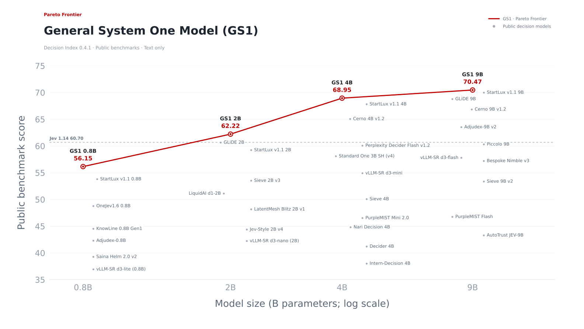

# GS1 — General System One

[English](README.md) · [简体中文](README.zh-CN.md)


> ***Fast, Faithful, Frontier System One Intelligence.***

GS1 是北京通用人工智能研究院开发的开源决策模型系列，具备快速决策与不确定性感知能力。它直接计算可变候选集合上的原生概率分布，用于智能体路由、验证、信息抽取和控制。

[代码](https://github.com/bigai-nlco/GS1) · [模型](https://huggingface.co/collections/bigai/gs1) · [文档](docs/README.zh-CN.md) · [Playground](playground/README.zh-CN.md)

## GS1 亮点

- **Fast — 原生运行时决策头。**
  - 直接输出 Choice、Noul、Score 分布，生成输出 token 数为零。
  - 原生多头交叉注意力决策头使用问题和候选表示查询状态证据。
  - 采用 CUDA Graph，GS1-0.8B 的单个短问题调用 P50 为 12.51 ms；八个短问题相对默认推理加速 **6.05×**。
- **Faithful — 多步强化学习与校准奖励。**
  - 强化学习用采样动作的真实概率计算 Brier 奖励。[RLCD](docs/RLCD.zh-CN.md)
  - 原生概率与置信度支持补充证据、延后判断和显式拒答选项。
- **Frontier — 混合架构，出色质量。**
  - **因果 Gated DeltaNet** 和 **分段双向全注意力** 让候选项获得完整比较上下文，同时保持不可变前缀，供不同问题复用。
  - 保留 carry 的 **Attention Residual** 让稀疏全注意力接收层查询早期表示，并保留显式跳跃连接锚点。[模型架构](docs/model.zh-CN.md)
  - GS1-4B 在最新 Decision Index 0.4.1 Public index 中获得 **68.97** 分；所有 GS1 尺寸均位于图示模型的参数量—性能前沿。

## 模型与成绩

| 模型 | Decision Index（Public index） | 权重 |
|---|---:|---|
| **GS1-0.8B** | **56.12** | [Hugging Face](https://huggingface.co/bigai/GS1-0.8B) |
| **GS1-2B** | **62.22** | [Hugging Face](https://huggingface.co/bigai/GS1-2B) |
| **GS1-4B** | **68.97** | [Hugging Face](https://huggingface.co/bigai/GS1-4B) |
| **GS1-9B** | **70.45** | [Hugging Face](https://huggingface.co/bigai/GS1-9B) |

实际存储参数量与来源信息见[完整结果](benchmark/results.md)。

以上为**最新完整公开套件评测结果**（edition 0.3）。四个模型均覆盖全部 **43 项文本基准**，覆盖率 **100%**，其中 **37 项基准**计入 Public index。[评测详情](benchmark/results.md)。




## 快速开始

### Hugging Face Transformers

需要 Python 3.11+。安装模型目录中的 `requirements.txt`，或对应的 PyTorch、Transformers 5.3.0、Accelerate、safetensors、Pydantic、TypeSafe SDK 和 Pillow 依赖。**无需安装或调用 `gs1` 仓库**。输入可使用本地发布目录，也可使用已上传的 Hub ID。

```bash
python -m pip install torch==2.9.1 torchvision==0.24.1 transformers==5.3.0 accelerate safetensors 'pydantic>=2.8,<3' typesafe-sdk==0.7.0 pillow
```

```python
import torch
from transformers import AutoModel

model = (
    AutoModel.from_pretrained(
        "bigai/GS1-0.8B",
        trust_remote_code=True,
    )
    .eval()
    .to("cuda")
)

request = {
    "state": "客户被重复扣费，要求尽快退款。",
    "questions": {
        "team": {
            "type": "choice",
            "instructions": "哪个团队应处理这张工单？",
            "criteria": {"billing": "支付和退款", "technical": "软件问题"},
        },
        "refund": {"type": "noul", "instructions": "客户是否要求退款？"},
        "urgency": {
            "type": "score",
            "instructions": "评估处理这张工单的紧急程度。",
            "criteria": ["常规", "尽快", "立即"],
        },
    },
}

with torch.autocast("cuda", dtype=torch.bfloat16, cache_enabled=False):
    result = model.decide(**request, precision="bf16")

print(result["answers"])
print(result["usage"])
```

结果包含 `model`、`answers`、`usage`，每个候选项都有概率。[完整三类型示例](examples/quickstart.py) · [请求 JSON](examples/request.json)

发布的 `chat_template.jinja` 与编译器共用序列化逻辑，直接生成包含 state、question 和 options 的原生 GS1 提示。`model.decide` 负责类型化候选处理和分支元数据。[原生模板用法](docs/inference.zh-CN.md#原生决策模板)

### GS1 运行时

采用 Linux/CUDA、Python 3.11+、PyTorch 2.9.1 和 Transformers 5.3.0：

```bash
git clone https://github.com/bigai-nlco/GS1.git
cd GS1
uv sync --locked --extra serve --extra cuda
```

```bash
uv run gs1 serve --model bigai/GS1-0.8B --model-name GS1
```

服务提供 `POST /v1/systemone` 和 `GET /v1/models`。[启用经过校验的 CUDA Graph 推理](docs/inference.zh-CN.md#cuda-graph-推理)，或通过 `from gs1 import Engine` 在进程内调用。优化运行时与 HF 模型共享架构计算和类型化输出定义。

### TypeSafe SDK

将[官方 TypeSafe Python SDK](https://github.com/typesafe-ai/typesafe-sdk-python) 指向上面启动的 GS1 服务；客户端只需安装 SDK：

```bash
python -m pip install typesafe-sdk==0.7.0
```

```python
from typesafe_sdk import Choice, Noul, Score, TypeSafeClient

with TypeSafeClient(
    base_url="http://127.0.0.1:9000",
    api_key="local",
    model="GS1",
) as client:
    result = client.system_one(
        state="客户被重复扣费，要求尽快退款。",
        questions={
            "team": Choice(
                instructions="哪个团队应处理这张工单？",
                criteria={"billing": "支付和退款", "technical": "软件问题"},
            ),
            "refund": Noul(instructions="客户是否要求退款？"),
            "urgency": Score(
                instructions="评估处理这张工单的紧急程度。",
                criteria=["常规", "尽快", "立即"],
            ),
        },
    )

print(result.choices["team"].choice)
print(result.choices["team"].probabilities)
print(result.nouls["refund"].noul)
print(result.scores["urgency"].score)
```

`api_key="local"` 用于满足 SDK 的必填参数，本地 GS1 不需要 TypeSafe 云端凭据。`base_url` 填 API 根地址，`model` 与服务的 `--model-name` 保持一致。[可运行示例](examples/typesafe_client.py) · [API 与置信度](docs/api.zh-CN.md)

## 推理性能

最新推理性能实测结果：

| 模型 | GS1 默认 P50 | GS1 eager P50 | CUDA Graph P50 / P95 | 加速比 | Graph 已分配显存 |
|---|---:|---:|---:|---:|---:|
| GS1-0.8B | 54.10 ms | 54.60 ms | **12.51 / 13.22 ms** | 4.32× | 4.07 GiB |
| GS1-2B | 53.95 ms | 54.34 ms | **18.64 / 18.69 ms** | 2.89× | 10.60 GiB |
| GS1-4B | 72.87 ms | 73.84 ms | **35.17 / 35.24 ms** | 2.07× | 23.68 GiB |

采用报告显存 48 GiB 的 RTX 4090、BF16 计算、**256 token／单问题**，每组预热五次、测量 30 次。计时覆盖**进程内完整决策调用**：输入校验、prompt 编译、模型执行、概率和类型化响应；排除模型加载、图捕获、HTTP 与 SDK 传输。GS1 默认指独立模型的 `model.decide` 路径；加速比为其 P50 与 CUDA Graph P50 的比值，权重与输入相同。保留权重的原始存储 dtype。


```bash
# 在源码仓库中运行，覆盖 256／1,024-token、单／八问题输入。
uv sync --locked --extra serve --extra cuda --extra eval
CUDA_VISIBLE_DEVICES=0 uv run python -m benchmark.latency \
  --model bigai/GS1-0.8B --out runs/latency/GS1-0.8B.json
```

[全部形状、P50／P95／P99、显存与测量方法](benchmark/latency.md) · [原始样本](benchmark/results/inference-latency.json) · [先前的服务／IPC 与副本测量](benchmark/results.md#latency-and-memory)

## 体验 Playground


Query 示例页面展示类型化 Choice／Noul／Score 结果、原始 JSON 和单次请求往返时延。[请求示例](examples/playground.json)。

```bash
cd playground
npm ci
npm run build
npm start
```

在端口 9000 启动 GS1 后，打开 [localhost:3000](http://127.0.0.1:3000)。通过 **Query** 编辑状态与问题、比较概率并查看原始 JSON。默认后端为 GS1；在 Node 服务端导出 `TYPESAFE_API_KEY` 后，可直接通过 TypeSafe 官方 API 使用 Jev。[设置与操作](playground/README.zh-CN.md)

## GS1 如何做决策


GS1 结合 Qwen3.5 混合序列建模、**分段双向全注意力**、**保留 carry 的 Attention Residuals** 和 **原生交叉注意力决策头**。候选项语义在推理时提供：Choice 选择候选项，Noul 返回 `p(true)`，Score 返回从零开始的等级期望。决策头不使用固定类别数的分类器；API 与上下文预算共同约束支持的请求。[架构和数值契约](docs/model.zh-CN.md)

## 文档与引用

[模型](docs/model.zh-CN.md) · [RLCD](docs/RLCD.zh-CN.md) · [推理](docs/inference.zh-CN.md) · [API](docs/api.zh-CN.md) · [评测](benchmark/README.zh-CN.md)

代码与发布模型权重采用 [Apache-2.0](LICENSE)。

如果本工作对您有帮助，欢迎引用。

```bibtex
@techreport{zheng2026gs1,
  title={GS1: Fast, Faithful, Frontier System One Intelligence},
  author={Zheng, Zilong and Liu, Yang and Qin, Shuhan and Lin, Ziyong and Li, Jiaqi and Jia, Zixia and Zhu, Song-Chun},
  institution={BIGAI},
  year={2026}
}
```
