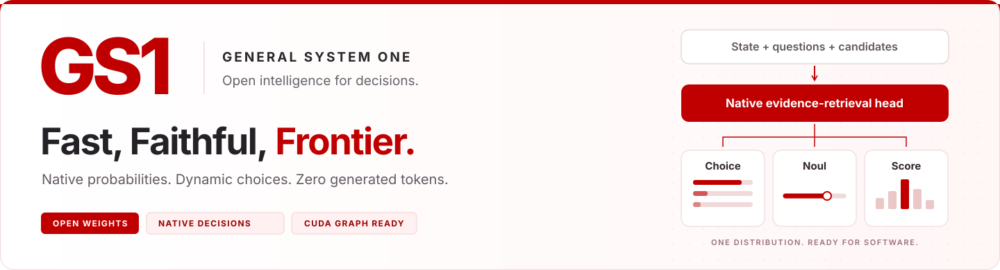
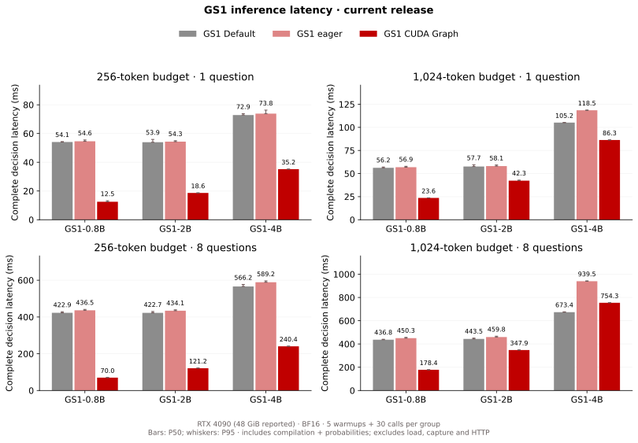
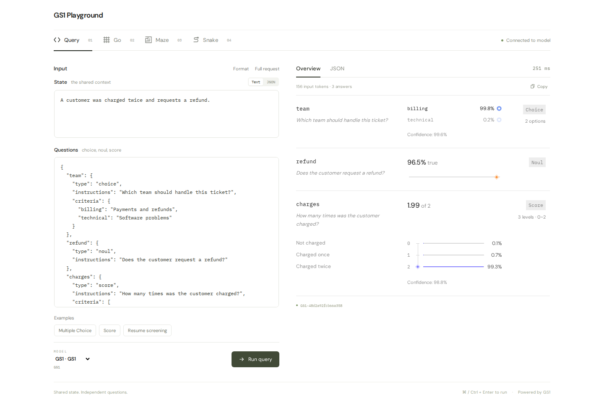
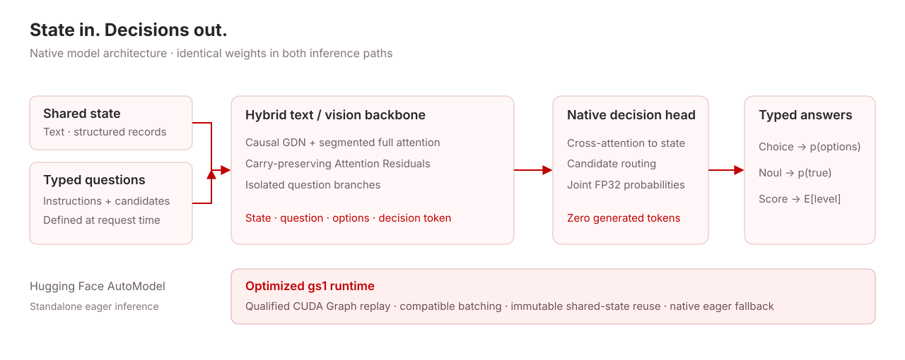

# GS1 — General System One

[English](README.md) · [简体中文](README.zh-CN.md)



**Fast, Faithful, Frontier.**
GS1 接收状态与运行时定义的问题，直接输出 **Choice、Noul、Score** 分布。原生交叉注意力决策头为候选项检索证据，推理不生成回答文本，输出 token 数为零。

[模型集合](https://huggingface.co/collections/bigai/gs1) · [快速开始](#快速开始) · [完整结果](docs/results.zh-CN.md) · [Playground](playground/README.zh-CN.md) · [模型架构](docs/model.zh-CN.md) · [文档](docs/README.zh-CN.md)

## Highlights

- **Fast — 直接决策，零文本解码。** 同一问题的全部候选项一起评分，直接返回完整概率分布。当前 0.8B 模型的单问题完整调用 **P50 为 12.51 ms**；在测得的八问题输入上，CUDA Graph 相对 HF 默认推理加速 **6.05×**。
- **Faithful — 围绕真正用于决策的概率学习。** CRPO 使用采样动作的真实概率计算 Brier 奖励。部署时，原生概率与置信度使程序能够延后不确定的判断、获取更多证据，或选择请求中提供的拒答选项。[概率与置信度](docs/api.zh-CN.md#置信度)
- **Frontier — 以原生决策头检索证据。** 分段双向注意力与保留 carry 的 Attention Residuals 为原生交叉注意力决策头提供表示，支持运行时定义的候选集合。报告的公开对比快照中，GS1-4B 得分 **68.95**，比 Jev 1.14 高 **8.25 分**；四个 GS1 尺寸均位于图示模型的参数量—性能前沿。[模型架构](docs/model.zh-CN.md)

## 模型与成绩

| 模型 | 报告快照 · 11 月 6 日 | 本地完整评测 · 11 月 7 日 | 权重 |
|---|---:|---:|---|
| **GS1-0.8B** | **56.15** | 56.12 | [Hugging Face](https://huggingface.co/bigai/GS1-0.8B) |
| **GS1-2B** | **62.22** | 62.22 | [Hugging Face](https://huggingface.co/bigai/GS1-2B) |
| **GS1-4B** | **68.95** | 68.97 | [Hugging Face](https://huggingface.co/bigai/GS1-4B) |
| **GS1-9B** | **70.47** | — | [Hugging Face](https://huggingface.co/bigai/GS1-9B) · 检查点待补齐 |

两列均为 **Decision Index 公共分数**，与包含私有任务的 Full 榜单分开。下图保留技术报告中 11 月 6 日、33 个公开对比模型的快照；11 月 7 日的本地评测完成全部 37 个公开 benchmark，每个型号 **115,479 个唯一请求、279,333 个决策，最终覆盖率 100%**。系列采用标称尺寸；含视觉塔和决策头的实际参数量与来源见[完整结果](docs/results.zh-CN.md)。

[](assets/gs1_pareto_frontier.pdf)

2026 年 11 月 9 日新增的完整测试集测量：

| Benchmark | Decisions | GS1-0.8B | GS1-2B | GS1-4B |
|---|---:|---:|---:|---:|
| JevBench public | 231 | 77.92% | 80.09% | 86.15% |
| AG News | 7,600 | 90.99% | 91.83% | 92.01% |
| ToolACE selection | 640 | 93.28% | 93.91% | 94.22% |

JevBench 对应固定版本公开任务，与包含密封题目的榜单综合分不同。ToolACE 测量固定哈希子集上的首次工具选择。[查看全部 37 项分数、五个领域、AA 组件、Brier、ECE 和来源 →](docs/results.zh-CN.md)

## 快速开始

### Hugging Face 默认推理

需要 Python 3.11+。安装模型目录中的 `requirements.txt`，或对应的 PyTorch、Transformers 5.3.0、Accelerate、safetensors、Pydantic、TypeSafe SDK 和 Pillow 依赖。**无需安装或调用 `gs1` 仓库**。输入可使用本地发布目录，也可使用已上传的 Hub ID。

```bash
python -m pip install torch==2.9.1 torchvision==0.24.1 transformers==5.3.0 accelerate safetensors 'pydantic>=2.8,<3' typesafe-sdk==0.7.0 pillow
```

```python
from transformers import AutoModel

model = (
    AutoModel.from_pretrained(
        "/path/to/GS1-0.8B",  # or a published bigai/GS1-0.8B Hub ID
        trust_remote_code=True,
    )
    .eval()
    .to("cuda")
)

result = model.decide(
    state="A customer was charged twice and requests a refund.",
    questions={
        "team": {
            "type": "choice",
            "instructions": "Which team should handle this ticket?",
            "criteria": {"billing": "Payments and refunds", "technical": "Software problems"},
        },
        "refund": {"type": "noul", "instructions": "Does the customer request a refund?"},
    },
)
print(result["answers"])
```

结果包含 `model`、`answers`、`usage`，每个候选项都有概率。[完整三类型示例](examples/quickstart.py) · [请求 JSON](examples/request.json)

### GS1 优化运行时

采用 Linux/CUDA、Python 3.11+、PyTorch 2.9.1 和 Transformers 5.3.0：

```bash
git clone https://github.com/bigai-nlco/GS1.git
cd GS1
uv sync --locked --extra serve --extra cuda
```

```bash
uv run gs1 serve --model /path/to/GS1-0.8B --model-name GS1
```

服务提供 `POST /v1/systemone` 和 `GET /v1/models`。[启用经过校验的 CUDA Graph 推理](docs/inference.zh-CN.md#cuda-graph-推理)，或通过 `from gs1 import Engine` 在进程内调用。优化运行时与 HF 模型共享架构计算和类型化输出定义。

### TypeSafe SDK

将[官方 TypeSafe Python SDK](https://github.com/typesafe-ai/typesafe-sdk-python) 指向上面启动的 GS1 服务；客户端只需安装 SDK：

```bash
python -m pip install typesafe-sdk==0.7.0
```

```python
from typesafe_sdk import Choice, Noul, Score, TypeSafeClient

with TypeSafeClient(
    base_url="http://127.0.0.1:8000",
    api_key="local",
    model="GS1",
) as client:
    result = client.system_one(
        state="A customer was charged twice and requests a refund.",
        questions={
            "team": Choice(
                instructions="Which team should handle this ticket?",
                criteria={"billing": "Payments and refunds", "technical": "Software problems"},
            ),
            "refund": Noul(instructions="Does the customer request a refund?"),
            "urgency": Score(
                instructions="Rate urgency.",
                criteria=["Routine", "Soon", "Immediate"],
            ),
        },
    )

print(result.choices["team"].choice)
print(result.choices["team"].probabilities)
print(result.nouls["refund"].noul)
print(result.scores["urgency"].score)
```

`api_key="local"` 用于满足 SDK 的必填参数，本地 GS1 不需要 TypeSafe 云端凭据。`base_url` 填 API 根地址，`model` 与服务的 `--model-name` 保持一致。[可运行示例](examples/typesafe_client.py) · [API 与置信度](docs/api.zh-CN.md)

## 推理性能

**2026 年 11 月 9 日**对当前发布代码的新增测量：

| 模型 | HF 默认 P50 | GS1 eager P50 | CUDA Graph P50 / P95 | 加速比 | Graph 已分配显存 |
|---|---:|---:|---:|---:|---:|
| GS1-0.8B | 54.10 ms | 54.60 ms | **12.51 / 13.22 ms** | 4.32× | 4.07 GiB |
| GS1-2B | 53.95 ms | 54.34 ms | **18.64 / 18.69 ms** | 2.89× | 10.60 GiB |
| GS1-4B | 72.87 ms | 73.84 ms | **35.17 / 35.24 ms** | 2.07× | 23.68 GiB |

采用报告显存 48 GiB 的 RTX 4090、BF16 计算、**256 token／单问题**，每组预热五次、测量 30 次。计时覆盖**进程内完整决策调用**：输入校验、prompt 编译、模型执行、概率和类型化响应；排除模型加载、图捕获、HTTP 与 SDK 传输。加速比使用相同权重、相同输入下 HF 默认推理的 P50；保留权重的原始存储 dtype。



```bash
# 在源码仓库中运行，覆盖 256／1,024-token、单／八问题输入。
uv sync --locked --extra serve --extra cuda --extra eval
CUDA_VISIBLE_DEVICES=0 uv run python -m benchmark.latency \
  --model /path/to/GS1-0.8B --out runs/latency/GS1-0.8B.json
```

[全部形状、P50／P95／P99、显存与测量方法](docs/latency.zh-CN.md) · [原始样本](benchmark/results/inference-latency.json) · [先前的服务／IPC 与副本测量](docs/results.zh-CN.md#延迟与显存)

## 体验 Playground



真实 GS1-0.8B 默认 eager 推理：三个问题，界面显示共享 GPU 上的 Node/HTTP 往返时间。性能表采用前文单独注明的 benchmark 设置。[复现此请求](examples/playground.json)。

```bash
cd playground
npm ci
npm run build
npm start
```

在端口 8000 启动 GS1 后，打开 [localhost:3000](http://127.0.0.1:3000)。**Query、Go、Maze、Snake** 展示模型概率和原始 JSON。默认后端为 GS1；Node 服务可配置可选的 Jev 对比后端。[设置与操作](playground/README.zh-CN.md)

## GS1 如何做决策



GS1 结合 Qwen3.5 混合序列建模、**分段双向全注意力**、**保留 carry 的 Attention Residuals** 和 **原生交叉注意力决策头**。候选项语义在推理时提供：Choice 选择候选项，Noul 返回 `p(true)`，Score 返回从零开始的等级期望。决策头不使用固定类别数的分类器；API 与上下文预算共同约束支持的请求。[架构和数值契约](docs/model.zh-CN.md)

## 文档与引用

[模型](docs/model.zh-CN.md) · [推理](docs/inference.zh-CN.md) · [API](docs/api.zh-CN.md) · [部署](docs/deployment.zh-CN.md) · [评测](benchmark/README.zh-CN.md) · [发布](docs/release.zh-CN.md) · [贡献指南](CONTRIBUTING.zh-CN.md)

代码采用 [Apache-2.0](LICENSE)；权重许可单独列在模型卡中。本次发布包含模型架构、推理、服务、演示与评测。

```bibtex
@techreport{zheng2026gs1,
  title={GS1: Fast, Faithful, Frontier System One Intelligence},
  author={Zheng, Zilong and Liu, Yang and Qin, Shuhan and Lin, Ziyong and Li, Jiaqi and Jia, Zixia and Zhu, Song-Chun},
  institution={BIGAI},
  year={2026}
}
```
