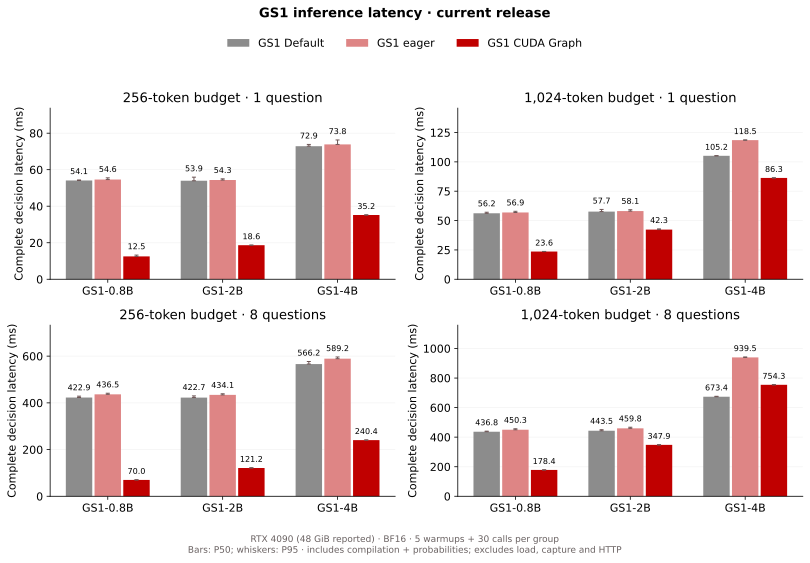

# GS1 inference latency

[English](latency.md) · [简体中文](latency.zh-CN.md)

## Current release · 9 November 2026

Three model sizes, two context lengths, one/eight questions and three inference paths: **36 groups, 1,080 timed calls and 4,860 logical decisions**. Each group uses five warmups and 30 measurements on a single RTX 4090 reporting 48 GiB, with two CPU threads. Computation is BF16; original FP32 text/head and BF16 vision storage dtypes are preserved.

All **12 shape qualifications passed**, with **zero measured logit drift and probability TV** against the native single-branch reference. Every timed graph group replayed resident graphs, with no graph rejection or fallback.



All latency values below are **milliseconds**. P50/P95 are sample quantiles; speedup is HF default P50 divided by CUDA Graph P50. Complete raw samples, P99, throughput, software hashes, checkpoint identity and qualification checks are in [the JSON record](../benchmark/results/inference-latency.json).

| Model | Longest branch | Questions | HF default P50 / P95 | GS1 eager P50 / P95 | CUDA Graph P50 / P95 | Speedup | Graph allocated / reserved |
|---|---:|---:|---:|---:|---:|---:|---:|
| GS1-0.8B | 256 | 1 | 54.10 / 54.36 | 54.60 / 55.53 | **12.51 / 13.22** | 4.32× | 4.07 / 4.21 GiB |
| GS1-0.8B | 256 | 8 | 422.88 / 428.70 | 436.52 / 441.17 | **69.95 / 70.61** | 6.05× | 4.08 / 4.38 GiB |
| GS1-0.8B | 1,024 | 1 | 56.20 / 57.11 | 56.88 / 57.90 | **23.59 / 23.70** | 2.38× | 4.11 / 4.45 GiB |
| GS1-0.8B | 1,024 | 8 | 436.83 / 440.67 | 450.27 / 456.94 | **178.41 / 178.75** | 2.45× | 4.14 / 4.90 GiB |
| GS1-2B | 256 | 1 | 53.95 / 55.91 | 54.34 / 54.98 | **18.64 / 18.69** | 2.89× | 10.60 / 10.82 GiB |
| GS1-2B | 256 | 8 | 422.67 / 429.82 | 434.10 / 438.86 | **121.15 / 122.07** | 3.49× | 10.61 / 11.03 GiB |
| GS1-2B | 1,024 | 1 | 57.65 / 59.49 | 58.08 / 59.23 | **42.31 / 42.90** | 1.36× | 10.62 / 11.45 GiB |
| GS1-2B | 1,024 | 8 | 443.48 / 450.52 | 459.82 / 466.96 | **347.88 / 348.71** | 1.27× | 10.66 / 12.12 GiB |
| GS1-4B | 256 | 1 | 72.87 / 73.85 | 73.84 / 76.28 | **35.17 / 35.24** | 2.07× | 23.68 / 23.96 GiB |
| GS1-4B | 256 | 8 | 566.18 / 577.23 | 589.18 / 596.40 | **240.44 / 241.26** | 2.35× | 23.70 / 24.33 GiB |
| GS1-4B | 1,024 | 1 | 105.17 / 105.28 | 118.52 / 118.67 | **86.30 / 86.41** | 1.22× | 23.69 / 25.12 GiB |
| GS1-4B | 1,024 | 8 | 673.43 / 676.56 | 939.46 / 942.40 | **754.28 / 755.02** | 0.89× | 23.73 / 25.95 GiB |

The short 0.8B graph call reaches **12.51 ms P50**, with **4.32×** speedup over HF default inference. The same size reaches **6.05×** on eight short questions. Benefits depend on shape: 4B at 1,024 tokens/eight questions takes **754.28 ms** with graphs versus **673.43 ms** through HF default inference, a **0.89×** ratio. Use the measured path that fits the workload.

## What is timed

- `hf_eager`: `model.decide(state, questions)` from the same native implementation distributed in the independent HF folders.
- `gs1_eager`: `Engine.evaluate` on the unbatched native reference path.
- `gs1_cuda_graph`: the reference engine with numerically checked native-row arithmetic, compatible question batching and resident CUDA Graph replay.

All paths share one loaded model object and identical inputs. Timers include validation, prompt compilation, forward computation, probability/confidence calculations, CPU answer materialization and typed-response construction. CUDA synchronizes around each call. Timers exclude weight loading, graph capture, network transport, SDK overhead and serialization to HTTP. This is a warm in-process decision measurement, not an HTTP round-trip measurement.

One request is in flight at a time. The single-question fixture is Choice with three candidates; the eight-question fixture mixes Choice, Noul and Score over a shared deterministic cargo state. Context is the actual longest complete branch; the JSON retains all branch lengths and candidate counts. Baselines and graphs use identical stored weights and compute precision. Graph capture checks eager parity, and each measured group must show replay hits with no resident-graph misses. Allocated and reserved GPU memory are reported separately and include the model and graph-owned buffers.

## Reproduce

```bash
uv sync --locked --extra serve --extra cuda --extra eval
CUDA_VISIBLE_DEVICES=0 uv run python -m benchmark.latency \
  --model /path/to/GS1-0.8B --out runs/latency/GS1-0.8B.json \
  --contexts 256 1024 --questions 1 8 --warmup 5 --repeats 30
```

Repeat with GS1-2B and GS1-4B. The tool refuses existing output paths, writes partial progress with `complete: false`, and marks successful final results `complete: true`. Shape/precision qualification must pass before recording graph latency. Graph budgets default to 8,192 MiB and 32 entries; adjust them for other workloads. The benchmark runs from the source checkout and is excluded from the `gs1` wheel.

```bash
# Redraw figures from the checked-in aggregate results.
uv run python -m benchmark.report
```

## Earlier measurements

The [7 November request experiment](results.md#latency-and-memory) contains 216 groups over larger contexts and GPU replicas. It includes preparation and worker/IPC overhead and retains its own timing boundary. The technical report's GS1-2B **16.00 ms** and **4.72×** results instead measure warm engine execution without request compilation or HTTP on a different fixture. Neither number is substituted into the current complete-call table.
