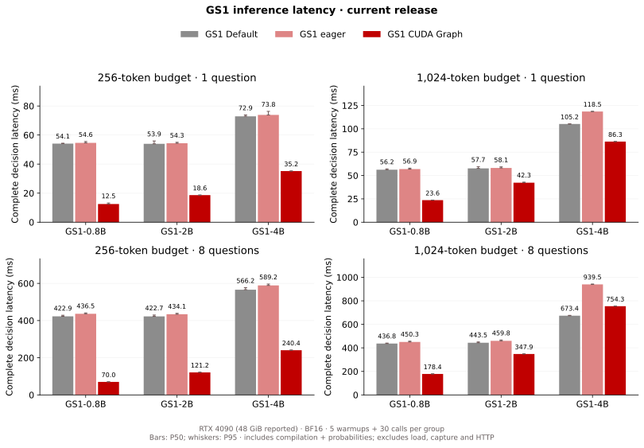

# GS1 推理时延

[English](latency.md) · [简体中文](latency.zh-CN.md)

## 当前发布代码 · 2026 年 11 月 9 日

覆盖三个型号、两种上下文长度、单／八问题与三条推理路径，共 **36 组、1,080 次计时调用、4,860 个逻辑决策**。每组预热五次、测量 30 次；使用单张报告显存 48 GiB 的 RTX 4090 和两个 CPU 线程。采用 BF16 计算，保留文本／决策头 FP32、视觉 BF16 的原始存储 dtype。

**12 个形状的数值校验全部通过**，相对原生单分支参考计算，测得 **logit 偏差和概率 TV 均为零**。每个图模式测量组都实际重放常驻图，无图拒绝或回退。



下表延迟单位均为 **毫秒**。P50／P95 采用样本分位数；加速比为 HF 默认 P50 除以 CUDA Graph P50。[JSON 记录](../benchmark/results/inference-latency.json)保留全部原始样本、P99、吞吐、软件哈希、检查点身份与数值校验。

| 模型 | 最长分支 | 问题数 | HF 默认 P50 / P95 | GS1 eager P50 / P95 | CUDA Graph P50 / P95 | 加速比 | Graph 已分配 / 保留显存 |
|---|---:|---:|---:|---:|---:|---:|---:|
| GS1-0.8B | 256 | 1 | 54.10 / 54.36 | 54.60 / 55.53 | **12.51 / 13.22** | 4.32× | 4.07 / 4.21 GiB |
| GS1-0.8B | 256 | 8 | 422.88 / 428.70 | 436.52 / 441.17 | **69.95 / 70.61** | 6.05× | 4.08 / 4.38 GiB |
| GS1-0.8B | 1,024 | 1 | 56.20 / 57.11 | 56.88 / 57.90 | **23.59 / 23.70** | 2.38× | 4.11 / 4.45 GiB |
| GS1-0.8B | 1,024 | 8 | 436.83 / 440.67 | 450.27 / 456.94 | **178.41 / 178.75** | 2.45× | 4.14 / 4.90 GiB |
| GS1-2B | 256 | 1 | 53.95 / 55.91 | 54.34 / 54.98 | **18.64 / 18.69** | 2.89× | 10.60 / 10.82 GiB |
| GS1-2B | 256 | 8 | 422.67 / 429.82 | 434.10 / 438.86 | **121.15 / 122.07** | 3.49× | 10.61 / 11.03 GiB |
| GS1-2B | 1,024 | 1 | 57.65 / 59.49 | 58.08 / 59.23 | **42.31 / 42.90** | 1.36× | 10.62 / 11.45 GiB |
| GS1-2B | 1,024 | 8 | 443.48 / 450.52 | 459.82 / 466.96 | **347.88 / 348.71** | 1.27× | 10.66 / 12.12 GiB |
| GS1-4B | 256 | 1 | 72.87 / 73.85 | 73.84 / 76.28 | **35.17 / 35.24** | 2.07× | 23.68 / 23.96 GiB |
| GS1-4B | 256 | 8 | 566.18 / 577.23 | 589.18 / 596.40 | **240.44 / 241.26** | 2.35× | 23.70 / 24.33 GiB |
| GS1-4B | 1,024 | 1 | 105.17 / 105.28 | 118.52 / 118.67 | **86.30 / 86.41** | 1.22× | 23.69 / 25.12 GiB |
| GS1-4B | 1,024 | 8 | 673.43 / 676.56 | 939.46 / 942.40 | **754.28 / 755.02** | 0.89× | 23.73 / 25.95 GiB |

0.8B 短输入图调用的 **P50 为 12.51 ms**，相对 HF 默认推理加速 **4.32×**；相同型号在八个短问题上达到 **6.05×**。收益随请求形状变化：4B 的 1,024 token／八问题输入，图调用为 **754.28 ms**，HF 默认调用为 **673.43 ms**，比值为 **0.89×**。应按实际工作负载选择测得更合适的路径。

## 计时范围

- `hf_eager`：独立 HF 目录分发的同一原生实现中的 `model.decide(state, questions)`。
- `gs1_eager`：不做问题批处理的原生参考 `Engine.evaluate`。
- `gs1_cuda_graph`：采用已通过数值检查的 native-row 算术、兼容问题批处理和常驻 CUDA Graph 重放的 reference 引擎。

三条路径共享同一个已加载模型对象，输入完全一致。计时包含输入校验、prompt 编译、前向计算、概率／置信度计算、答案搬至 CPU 和类型化响应构造，每次调用前后均同步 CUDA；排除权重加载、图捕获、网络传输、SDK 开销与 HTTP 序列化。这是进程内热决策测量，不是 HTTP 往返测量。

任一时刻仅有一个请求执行。单问题输入为三个候选项的 Choice；八问题输入混合 Choice、Noul、Score，共享确定性的 cargo 状态。上下文长度取实际最长完整分支，JSON 保留所有分支长度和候选数。各路径使用相同存储权重和计算精度。图捕获检查 eager 一致性，测量组还必须实际命中重放且不发生常驻图未命中。已分配和保留显存分别报告，包含模型及图持有的缓冲区。

## 复现

```bash
uv sync --locked --extra serve --extra cuda --extra eval
CUDA_VISIBLE_DEVICES=0 uv run python -m benchmark.latency \
  --model /path/to/GS1-0.8B --out runs/latency/GS1-0.8B.json \
  --contexts 256 1024 --questions 1 8 --warmup 5 --repeats 30
```

分别替换为 GS1-2B、GS1-4B。工具拒绝覆盖已有输出，进行中的记录为 `complete: false`，成功结束后为 `complete: true`；形状／精度校验通过后才记录图时延。图预算默认为 8,192 MiB、32 个条目，其他工作负载可显式调整。基准工具从源码仓库运行，不包含在 `gs1` wheel 中。

```bash
# 从仓库内的聚合结果重新绘图。
uv run python -m benchmark.report
```

## 历史测量

[11 月 7 日请求实验](results.zh-CN.md#延迟与显存)包含 216 组更长上下文与多 GPU 副本测量，计时包含准备和 worker／IPC。技术报告中的 GS1-2B **16.00 ms**、**4.72×** 则来自另一输入上的热引擎时间，排除请求编译与 HTTP；不将两种结果代入本次完整调用表格。
