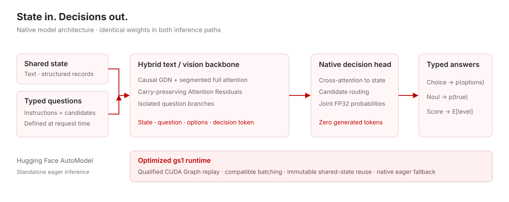
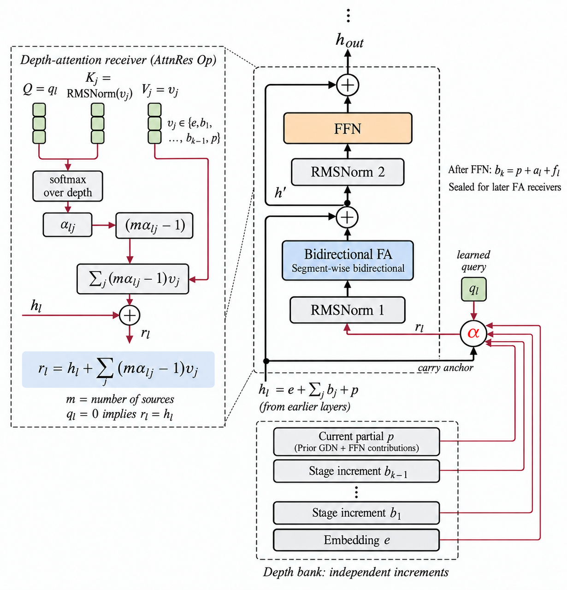

# GS1 model

[English](model.md) · [简体中文](model.zh-CN.md)

The canonical architecture is [`modular_gs1.py`](../gs1/model/modular_gs1.py). `GS1Config`, `GS1PretrainedModel`, `GS1TextModel` and `GS1Model` retain a native Transformers-style hierarchy. The same source is distributed in each Hugging Face model folder. `compiler.py` contains prompt compilation and branch execution; `schema.py` contains typed decisions, calibration, probability and confidence calculations; `util.py` contains checkpoint loading, serialization and identities. Native GDN prefix state and chunk continuation are defined here too, so the standalone model has no dependency on the optimized runtime. Tensor-tree copying, slicing and batching belong to `gs1.inference.state`; accelerated arithmetic belongs to `gs1.inference.arithmetic`.

## Backbone and evidence retrieval

GS1 uses Qwen3.5 text and vision operators. It owns `language_model.*`, `visual.*`, `decision_head.*`, and optional `calibrator.*` parameters directly. There is no language-generation output head. The released checkpoints preserve their complete parameter tree and mixed storage dtypes.

- **Hybrid mixing:** the published backbones interleave three causal Gated DeltaNet layers with one full-attention layer.
- **Segmented bidirectionality:** state tokens read state; questions read state and their question; all candidates within one question read their joint candidate context; a terminal decision token reads preceding roles. Earlier roles cannot read that terminal token. Sibling questions have separate branches. GDN remains causal.
- **Carry-preserving Attention Residuals:** full-attention receivers route over embedding and independent depth increments. The correction is `sum((m * alpha - 1) * source)` added to the original carry. Zero router queries preserve the carry at the same attention mask.
- **Native decision head:** pooled question and candidate representations query state evidence through multi-head cross-attention. The final normalized comparison vectors yield one FP32 logit per candidate and one joint probability distribution.

Question and option spans use the fixed compiler pooling rule: with bidirectionality, average opening delimiter, mean content and closing delimiter; causal pooling uses content and closing delimiter. User text is XML-escaped. The dedicated structural tokens are `<state>`, `</state>`, `<question>`, `</question>`, `<option>`, `</option>` and `<|decide|>`.

Head-level permutation equivalence holds when candidate order is restored and the input representations are fixed. The full backbone also uses positions and causal GDN, so this property does not imply complete-model option-order invariance.

## Published configurations

| Family | Stored parameters | Hidden width | Decoder layers | Decision heads |
|---|---:|---:|---:|---:|
| GS1-0.8B | 879,765,056 | 1,024 | 24 | 4 |
| GS1-2B | 2,319,227,200 | 2,048 | 24 | 8 |
| GS1-4B | 4,704,520,192 | 2,560 | 32 | 10 |

All three have two candidate-routing layers and a 256-dimensional final comparison space. Read the checkpoint's own `config.json`; do not replace its settings with one global architecture preset.

The serving exports permit 32,768 tokens per complete branch, 512 questions, and 131,072 logical request tokens. Actual supported shapes also depend on execution and memory budgets. The default HTTP service uses tighter admission limits; see [deployment](deployment.md). The complete public evaluation used 32k branch limits. The retained vision tower uses the complete-branch path; the reported decision benchmarks are text-only.

## Precision and output

The native checkpoints store text/head parameters in FP32 and vision parameters in their exported BF16 dtype. `head_compute_dtype` records BF16 head computation. Default loading preserves stored dtypes. Computation precision is selected separately; a blanket weight conversion changes the numerical policy and requires new qualification.

`GS1Model.forward` accepts tensor inputs plus compiled `branch` or `branches` metadata and returns logits and hidden states. Without branch metadata, it returns hidden states. `model.decide(state, questions)` is the convenient default path: it compiles inputs and evaluates complete branches with no graph capture or GS1 package dependency.

Choice returns the first maximum in request order with all candidate probabilities; Noul returns `p(true)`; Score returns the probability-weighted zero-based level, not a normalized scalar. Optional scalar temperature is loaded as part of the model; no calibration is fitted during inference. [Confidence formulas](api.md#confidence)

## Loading and saving

Use `AutoModel.from_pretrained(..., trust_remote_code=True)` for a standalone model folder, or `GS1Model.from_pretrained(...)` after installing GS1. Both accept local directories and Hub IDs. `revision`, `local_files_only`, `cache_dir` and token-based Hub access are supported. Single-device loading is explicit; automatic device sharding is not exposed by this loader.

`save_pretrained` writes standard safetensors shards, configuration and AutoClass code. Include the tokenizer/processor assets in a complete inference folder. Architecture, structural token IDs and `inference_limits` live in `config.json`; no separate serving manifest is required. Original tensor keys and dtypes round-trip exactly. The optimized runtime computes checkpoint identity from the actual weights, configuration and input-encoding assets when loading.
