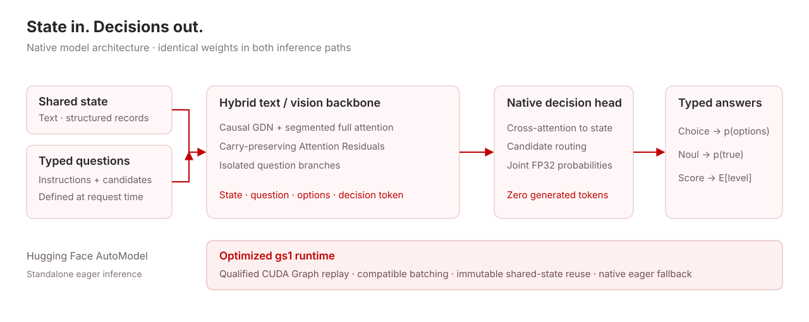
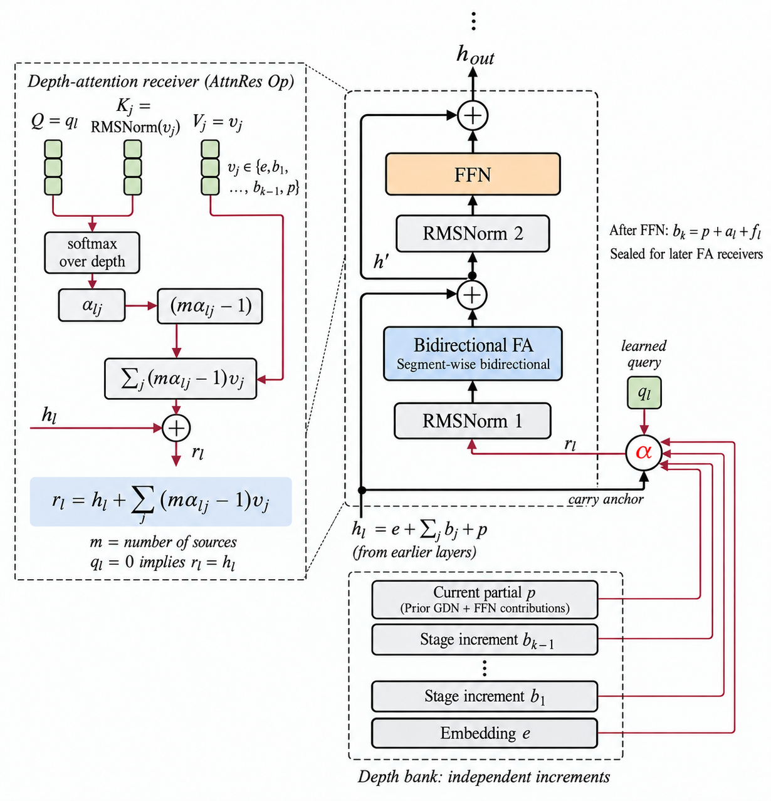

# GS1 模型

[English](model.md) · [简体中文](model.zh-CN.md)

标准架构实现位于 [`modular_gs1.py`](../gs1/model/modular_gs1.py)。`GS1Config`、`GS1PretrainedModel`、`GS1TextModel`、`GS1Model` 保留原生 Transformers 风格的继承结构；同一源码随每个 HF 模型目录分发。`compiler.py` 集中提示词编译与分支执行，`schema.py` 集中决策类型、校准、概率与置信度计算，`util.py` 集中检查点加载、序列化和身份计算。原生 GDN 前缀状态和分块续算也定义于此，因此独立模型不依赖优化运行时。张量树复制、切片和批处理位于 `gs1.inference.state`，加速算术位于 `gs1.inference.arithmetic`。

## 骨干与证据检索

GS1 复用 Qwen3.5 文本与视觉算子，直接持有 `language_model.*`、`visual.*`、`decision_head.*` 和可选 `calibrator.*` 参数，不包含文本生成输出头。发布检查点保留完整参数树与混合存储 dtype。

- **混合序列建模**：发布骨干采用三层因果 Gated DeltaNet 与一层全注意力交替的结构。
- **分段双向注意力**：状态只读取状态；问题读取状态及本问题；同一问题中的所有候选项共享候选上下文；终止决策 token 读取前面的角色。早期角色不能读取终止 token，不同问题分支隔离。GDN 仍为因果。
- **保留 carry 的 Attention Residuals**：在全注意力接收层，对 embedding 和独立深度增量路由；以 `sum((m * alpha - 1) * source)` 修正原始 carry。在同一注意力掩码下，零查询保持原 carry。
- **原生决策头**：池化的问题与候选表示通过多头交叉注意力检索状态证据，最终归一化比较向量为每个候选产生一个 FP32 logit，再得到联合概率分布。

问题与候选使用固定编译器池化规则：双向模式平均开标签、内容均值、闭标签；因果模式平均内容与闭标签。用户文本经过 XML 转义。七个专用结构 token 为 `<state>`、`</state>`、`<question>`、`</question>`、`<option>`、`</option>`、`<|decide|>`。

在输入表示固定、候选顺序还原时，决策头具有排列等价性；完整骨干还包含位置编码和因果 GDN，因此不能将此性质推广为整个模型对选项顺序不敏感。

## 发布配置

| 系列 | 实际存储参数 | 隐藏宽度 | Decoder 层数 | 决策注意力头数 |
|---|---:|---:|---:|---:|
| GS1-0.8B | 879,765,056 | 1,024 | 24 | 4 |
| GS1-2B | 2,319,227,200 | 2,048 | 24 | 8 |
| GS1-4B | 4,704,520,192 | 2,560 | 32 | 10 |

三个检查点均采用两层候选路由和 256 维最终比较空间。请读取各自的 `config.json`，不要用统一默认配置替换已有架构设置。

发布服务导出允许每条完整分支最多 65,536 token、每请求 512 个问题、逻辑请求总量 131,072 token；实际可用形状还取决于执行和显存预算。HTTP 服务默认采用更紧的准入参数，见[推理预算](inference.zh-CN.md#预算与测量)。完整公开评测使用 32k 分支上限。视觉塔保留完整分支推理路径；本文展示的决策 benchmark 均为纯文本。

## 精度与输出

原生检查点的文本／决策头参数为 FP32，视觉参数保留导出的 BF16 dtype；`head_compute_dtype` 记录 BF16 决策头计算。默认加载不改变存储 dtype。计算精度单独选择；整体转换权重 dtype 会改变数值策略，需要重新校验。

`GS1Model.forward` 接收张量及编译后的 `branch`／`branches` 元数据，返回 logits 和隐藏状态；未传分支元数据时返回隐藏状态。`model.decide(state, questions)` 提供便捷默认入口，执行请求编译与完整分支计算，无需图捕获或安装 GS1 包。

Choice 返回按请求顺序取到的首个最大项及完整概率；Noul 返回 `p(true)`；Score 返回从零开始的等级加权期望，不是归一化标量。可选温度随模型读取，推理阶段不拟合校准参数。[置信度公式](api.zh-CN.md#置信度)

## 加载与保存

独立模型目录使用 `AutoModel.from_pretrained(..., trust_remote_code=True)`；安装 GS1 后也可使用 `GS1Model.from_pretrained(...)`。均支持本地目录和 Hub ID，以及 `revision`、`local_files_only`、`cache_dir` 与 Hub token。单设备放置显式指定；此加载器不提供自动设备切分。

`save_pretrained` 保存标准 safetensors 分片、配置和 AutoClass 代码；完整推理目录还需包含 tokenizer／processor。架构、结构 token ID 和 `inference_limits` 统一保存在 `config.json`，无需独立服务 manifest。权重键及 dtype 严格往返一致；优化运行时加载时，按实际权重、配置和输入编码文件计算检查点身份。
