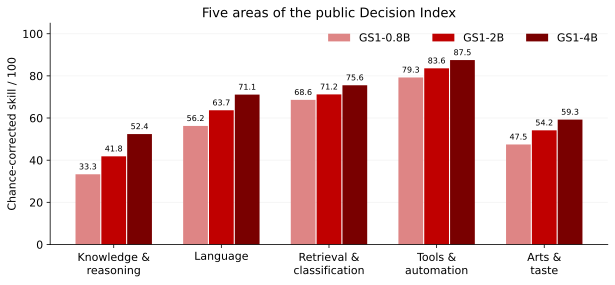
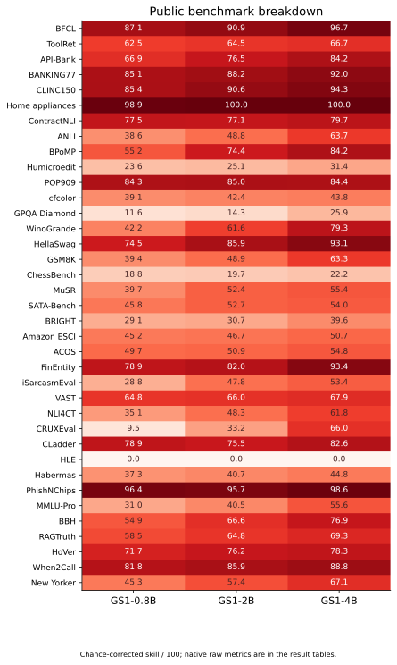
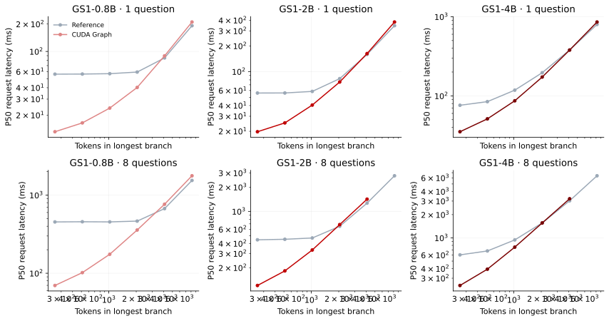
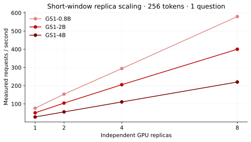

# GS1 results

[English](results.md) · [简体中文](results.zh-CN.md)

## Complete public Decision Index

The 7 November 2026 evaluation completed **37 public benchmarks plus four AA component suites** for each released checkpoint: **115,479 unique requests, 279,333 decisions, 100% final coverage, zero final failed requests**. Public index scores are **56.12 / 62.22 / 68.97** for 0.8B / 2B / 4B. Raw indices before chance correction are **67.36 / 71.70 / 76.47**.

The public suite is edition 0.3, in the lineage used by the Decision Index 0.4/0.4.1 public text board. These are local complete-public-panel results, not private Full scores. Weight identities match the release folders. The public inputs' SHA-256 is `da54e19b63c2b42f5e1b33f0f559c6b793659e883d887dcedaf2ce4c84f6c97b`. Source commit, aggregate-file hashes, predictor IDs and original safetensors hashes are retained in [the machine-readable record](../benchmark/results/public-evaluation.json).

The run used BF16 computation, FP32 persistent text/head parameters and single-branch native reference execution. Context was extended to 32,768 tokens: two unchanged over-limit inputs for 0.8B and 2B were replayed successfully; 4B used 32k from its first request. No input text or weights changed, and no successful input was dropped. This distinguishes final coverage from first-attempt success.

### Five areas

Scores below are chance-corrected skill ×100. Area weights are applied after each benchmark's native metric and its coverage/chance correction.

| Area | Weight | GS1-0.8B | GS1-2B | GS1-4B |
|---|---:|---:|---:|---:|
| Knowledge & Reasoning | 0.258494 | 33.32 | 41.84 | 52.40 |
| Language Understanding | 0.258494 | 56.25 | 63.67 | 71.12 |
| Retrieval & Classification | 0.200229 | 68.62 | 71.21 | 75.55 |
| Tools & Automation | 0.182783 | 79.26 | 83.57 | 87.49 |
| Arts & Human Taste | 0.100000 | 47.47 | 54.17 | 59.26 |




### All 37 native benchmarks

Raw and skill are displayed on a 0–100 scale. Raw uses the named native metric, including F1, nDCG, exact-case or consensus scoring where appropriate; it is not one universal accuracy. All listed coverage values are 100%.

| Benchmark | Native metric | Requests | Raw: 0.8B / 2B / 4B | Skill: 0.8B / 2B / 4B |
|---|---|---:|---:|---:|
| BFCL | case exact accuracy | 1,694 | 90.44 / 93.27 / 97.52 | 87.09 / 90.92 / 96.65 |
| ToolRet | nDCG@10 | 685 | 67.52 / 69.25 / 71.16 | 62.49 / 64.49 / 66.69 |
| API-Bank | accuracy | 508 | 67.52 / 76.97 / 84.45 | 66.89 / 76.53 / 84.15 |
| BANKING77 | macro-F1 | 3,080 | 85.33 / 88.34 / 92.09 | 85.14 / 88.19 / 91.99 |
| CLINC150 | macro-F1 | 5,500 | 85.51 / 90.61 / 94.35 | 85.42 / 90.55 / 94.32 |
| Home appliances | case exact accuracy | 88 | 98.86 / 100.00 / 100.00 | 98.86 / 100.00 / 100.00 |
| ContractNLI | conservative macro-F1 | 123 | 84.41 / 84.14 / 85.99 | 77.46 / 77.06 / 79.74 |
| ANLI | macro-F1 | 3,200 | 58.98 / 65.80 / 75.74 | 38.56 / 48.77 / 63.66 |
| BPoMP | variant-macro accuracy | 5,000 | 77.59 / 87.17 / 92.09 | 55.19 / 74.35 / 84.18 |
| Humicroedit | accuracy | 2,628 | 61.80 / 62.56 / 65.68 | 23.59 / 25.11 / 31.35 |
| POP909 | song-macro accuracy | 2,000 | 84.40 / 85.15 / 84.56 | 84.27 / 85.04 / 84.44 |
| cfcolor | user-macro accuracy | 5,000 | 69.57 / 71.21 / 71.88 | 39.13 / 42.42 / 43.77 |
| GPQA Diamond | accuracy | 196 | 33.67 / 35.71 / 44.39 | 11.56 / 14.29 / 25.85 |
| WinoGrande | accuracy | 1,267 | 71.11 / 80.82 / 89.66 | 42.22 / 61.64 / 79.32 |
| HellaSwag | accuracy | 10,042 | 80.85 / 89.44 / 94.81 | 74.47 / 85.92 / 93.08 |
| GSM8K | accuracy | 2,638 | 49.47 / 57.35 / 69.37 | 39.44 / 48.95 / 63.31 |
| ChessBench | best-move accuracy | 5,000 | 25.44 / 26.24 / 28.60 | 18.79 / 19.66 / 22.23 |
| MuSR | accuracy | 752 | 62.10 / 70.08 / 71.94 | 39.75 / 52.43 / 55.39 |
| SATA-Bench | case exact accuracy | 1,650 | 46.48 / 53.33 / 54.61 | 45.77 / 52.71 / 54.01 |
| BRIGHT | nDCG@10 | 220 | 37.32 / 38.75 / 46.58 | 29.10 / 30.71 / 39.57 |
| Amazon ESCI | conservative macro-F1 | 5,000 | 56.30 / 57.51 / 60.69 | 45.18 / 46.71 / 50.70 |
| ACOS | per-review F1 | 1,565 | 51.22 / 52.45 / 56.19 | 49.66 / 50.93 / 54.79 |
| FinEntity | macro-F1 | 979 | 85.65 / 87.77 / 95.53 | 78.89 / 82.01 / 93.43 |
| iSarcasmEval | sarcasm F1 (A English) | 4,600 | 44.64 / 59.44 / 63.76 | 28.78 / 47.83 / 53.37 |
| VAST | conservative macro-F1 | 3,006 | 76.52 / 77.34 / 78.62 | 64.78 / 66.01 / 67.93 |
| NLI4CT | macro-F1 | 5,500 | 66.64 / 73.41 / 80.38 | 35.10 / 48.27 / 61.83 |
| CRUXEval | accuracy | 570 | 42.98 / 57.89 / 78.60 | 9.54 / 33.20 / 66.04 |
| CLadder | accuracy | 5,000 | 89.44 / 87.74 / 91.30 | 78.88 / 75.48 / 82.60 |
| HLE | accuracy | 501 | 14.97 / 13.97 / 11.98 | 0.00 / 0.00 / 0.00 |
| Habermas | tie-accepting accuracy | 1,676 | 56.80 / 59.13 / 61.93 | 37.31 / 40.68 / 44.75 |
| PhishNChips | accuracy | 2,000 | 98.20 / 97.85 / 99.30 | 96.40 / 95.70 / 98.60 |
| MMLU-Pro | accuracy | 12,032 | 38.66 / 47.10 / 60.51 | 31.01 / 40.50 / 55.58 |
| BBH | accuracy | 5,507 | 68.88 / 76.96 / 84.07 | 54.89 / 66.60 / 76.91 |
| RAGTruth | F1 on hallucinated class | 2,700 | 79.96 / 83.00 / 85.20 | 58.45 / 64.75 / 69.31 |
| HoVer | accuracy | 4,000 | 85.85 / 88.10 / 89.15 | 71.70 / 76.20 / 78.30 |
| When2Call | accuracy | 3,652 | 86.39 / 89.40 / 91.59 | 81.85 / 85.87 / 88.79 |
| New Yorker | accuracy | 528 | 56.25 / 65.91 / 73.67 | 45.31 / 57.39 / 67.09 |




[CSV](../benchmark/results/decision-index.csv) · [JSON with tracks and chance levels](../benchmark/results/public-evaluation.json) · [Official-script reproduction](../benchmark/di/README.md)

## Regular benchmark measurements

Fresh reference-engine runs on 9 November 2026 used the same three checkpoint weight identities, BF16 computation, zero retries and all selected records. Each model completed **8,471 requests with zero failures**: 231 JevBench public tasks, the 7,600-record AG News test split and 640 accepted ToolACE conversations selected by the fixed hash rule.

| Model | Benchmark | Accuracy | Brier ↓ | ECE ↓ |
|---|---|---:|---:|---:|
| GS1-0.8B | JevBench public | 77.92% | 0.297093 | 0.052018 |
| GS1-0.8B | AG News | 90.99% | 0.137660 | 0.011330 |
| GS1-0.8B | ToolACE selection | 93.28% | 0.098948 | 0.018128 |
| GS1-2B | JevBench public | 80.09% | 0.246713 | 0.055576 |
| GS1-2B | AG News | 91.83% | 0.126385 | 0.005640 |
| GS1-2B | ToolACE selection | 93.91% | 0.100306 | 0.030303 |
| GS1-4B | JevBench public | 86.15% | 0.179350 | 0.050455 |
| GS1-4B | AG News | 92.01% | 0.122275 | 0.016153 |
| GS1-4B | ToolACE selection | 94.22% | 0.088759 | 0.027009 |


JevBench is pinned to `fcc69279a933f882ccc4489eb14bf467647dbdb7` and includes Easy, Original and Hard. The reported number is public task accuracy, not its sealed composite/rank. ToolACE measures the first single-tool/no-tool choice, not argument generation or execution; multi-tool first calls and malformed conversations are outside this adaptation. Brier is the full multiclass expected sum; Noul uses two classes. ECE uses ten equal-width bins of top-label probability. All metrics retain the measured denominator, and no test-set calibration is fitted. [Aggregates, bins and source hashes](../benchmark/results/regular-benchmarks.json)

## AA v1 public components

| Component | Metric | GS1-0.8B | GS1-2B | GS1-4B |
|---|---|---:|---:|---:|
| AA-Omniscience accuracy | accuracy | 36.17% | 39.67% | 47.83% |
| AA-Omniscience NHR | non_hallucination_rate | 0.78% | 0.00% | 0.00% |
| HLE multiple-choice | accuracy | 16.18% | 15.20% | 12.28% |
| When2Call | accuracy | 83.20% | 86.74% | 77.36% |
| WildGuard | average_f1 | 89.12% | 91.20% | 91.58% |


The complete local v1 aggregate is **51.74 / 53.24 / 51.28**. This is a historical public adaptation, separate from the current official AA index. Omniscience uses 600 public five-option questions rather than the official private population; WildGuard uses 856 locally frozen rows rather than the official 835-row subset. HLE has 513 records and When2Call 3,423. NHR is `abstained / (abstained + wrong)`, with 1 when both are zero. Confidence rejection was not applied to these component results; zero NHR therefore remains visible alongside accuracy. [Protocol and inputs](../benchmark/aadi/README.md)

## Latency and memory

See [inference latency](latency.md) for the 9 November comparison of complete HF/eager/CUDA Graph calls in the current release. The 7 November worker/IPC request timings and replica experiment below retain their original measurement boundary.

| Model | Reference P50 | CUDA Graph P50 / P95 | Speedup | Peak allocated |
|---|---:|---:|---:|---:|
| GS1-0.8B | 56.38 ms | **13.16 / 14.19 ms** | 4.28× | 4.07 GiB |
| GS1-2B | 56.11 ms | **19.75 / 20.09 ms** | 2.84× | 10.60 GiB |
| GS1-4B | 76.06 ms | **35.22 / 36.53 ms** | 2.16× | 23.68 GiB |


Source measurements: RTX 4090 devices reporting 48 GiB, BF16 computation, fixed weights and tested native arithmetic. The table uses one question and a 256-token longest branch, 20 measured requests per GPU, warmed execution, one independent GPU replica. Request P50/P95 include preparation and local worker/IPC overhead and exclude model load and graph capture. Reserved GPU memory is also present in the [raw measurements](../benchmark/results/latency.json), separately from allocated memory.



The recorded experiment contains **216 groups, 12,240 measured requests and 55,080 questions**, over 256–8,192 token branches, one/eight questions, three sizes and one/two/four/eight GPU replicas. Its audit records zero logit drift and probability TV on the qualified checks. Eight requested graph groups used native fallback: 2B at 8,192 tokens/eight questions exceeded graph residency, and the analogous 4B shape had a graph-capture OOM exclusion. The graph curves include only actual qualified graph execution.



Replica throughput is a short-window measurement with 20 requests per replica, not a sustained-load service guarantee. No speed comparison to hosted Jev is inferred from these local measurements.

The technical report separately measures warm GS1-2B engine medians of **16.00 / 93.87 / 357.76 ms** for one/eight/32 questions, against **54.12 / 423.61 / 1,689.74 ms** single-reference baselines: **3.38× / 4.51× / 4.72×**. That experiment excludes HTTP, request compilation and capture and uses a different fixture; its timing must not be merged with the request-latency curves above.

## Reproduction and figure sources

[Evaluation commands](../benchmark/README.md) · [Inference qualification](inference.md) · [Official Decision Index scripts](../benchmark/di/README.md).

```bash
uv sync --locked --extra eval
uv run python -m benchmark.report
```

This redraws the five quantitative SVG/PNG figures from aggregate JSON under `benchmark/results`; it does not run models or modify benchmark data. The 9B report value remains separate until its checkpoint can be validated.

The homepage Pareto figure is preserved separately from its supplied PDF. Convert it with `uv run --no-project --with pymupdf python scripts/convert_pareto.py`; its 6 November report snapshot scores remain distinct from the 7 November local evaluation. `benchmark.report` writes the [local size comparison](../assets/model-size-results.svg) and leaves `model-quality.svg` intact.
