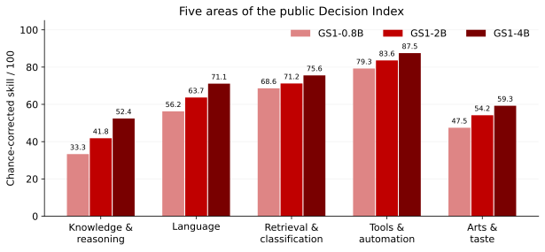
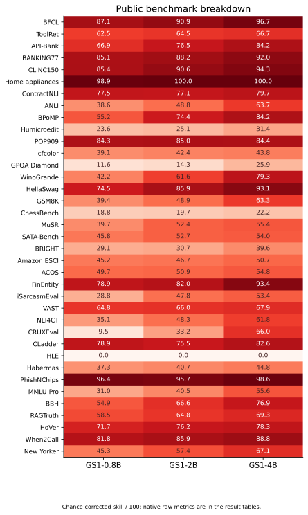
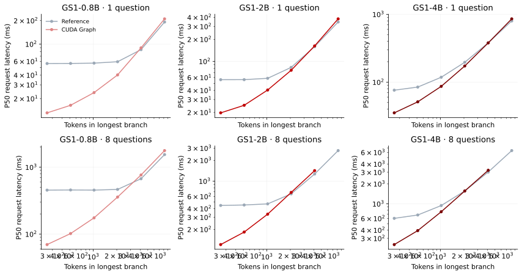
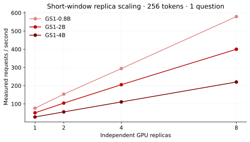

# GS1 评测结果

[English](results.md) · [简体中文](results.zh-CN.md)

## 完整公共 Decision Index

2026 年 11 月 7 日的评测对每个发布检查点完成 **37 个公开 benchmark 加四个 AA 组件**，各含 **115,479 个唯一请求、279,333 个决策，最终覆盖率 100%，最终失败数为零**。0.8B／2B／4B 的公共指数为 **56.12／62.22／68.97**，随机校正前的 raw index 为 **67.36／71.70／76.47**。

公开套件为 0.3 版，属于 Decision Index 0.4／0.4.1 公共文本榜使用的谱系。这是本地完整公共面板结果，不是私有 Full 分数。权重身份与发布目录一致；输入 SHA-256 为 `da54e19b63c2b42f5e1b33f0f559c6b793659e883d887dcedaf2ce4c84f6c97b`。[机器可读记录](../benchmark/results/public-evaluation.json)保留源码 commit、汇总文件哈希、predictor ID 和原始 safetensors 哈希。

运行采用 BF16 计算、FP32 文本／决策头常驻参数和原生单分支 reference。上下文扩展为 32,768 token：0.8B 与 2B 各重放两个原先超限、内容未变的输入并成功，4B 从首次请求即使用 32k。未修改文本或权重，也未丢弃成功输入；最终完整覆盖与首次全部成功分别说明。

### 五个领域

下表为随机校正 skill ×100；先使用各 benchmark 原生指标和覆盖／随机校正，再应用领域权重。

| Area | Weight | GS1-0.8B | GS1-2B | GS1-4B |
|---|---:|---:|---:|---:|
| Knowledge & Reasoning | 0.258494 | 33.32 | 41.84 | 52.40 |
| Language Understanding | 0.258494 | 56.25 | 63.67 | 71.12 |
| Retrieval & Classification | 0.200229 | 68.62 | 71.21 | 75.55 |
| Tools & Automation | 0.182783 | 79.26 | 83.57 | 87.49 |
| Arts & Human Taste | 0.100000 | 47.47 | 54.17 | 59.26 |




### 全部 37 个 benchmark

Raw 与 skill 均按 0–100 展示。Raw 使用该行标注的原生指标，可能是 F1、nDCG、整例准确率或共识评分，并非统一的准确率。表中覆盖率均为 100%。

| Benchmark | Native metric | Requests | Raw: 0.8B / 2B / 4B | Skill: 0.8B / 2B / 4B |
|---|---|---:|---:|---:|
| BFCL | case exact accuracy | 1,694 | 90.44 / 93.27 / 97.52 | 87.09 / 90.92 / 96.65 |
| ToolRet | nDCG@10 | 685 | 67.52 / 69.25 / 71.16 | 62.49 / 64.49 / 66.69 |
| API-Bank | accuracy | 508 | 67.52 / 76.97 / 84.45 | 66.89 / 76.53 / 84.15 |
| BANKING77 | macro-F1 | 3,080 | 85.33 / 88.34 / 92.09 | 85.14 / 88.19 / 91.99 |
| CLINC150 | macro-F1 | 5,500 | 85.51 / 90.61 / 94.35 | 85.42 / 90.55 / 94.32 |
| Home appliances | case exact accuracy | 88 | 98.86 / 100.00 / 100.00 | 98.86 / 100.00 / 100.00 |
| ContractNLI | conservative macro-F1 | 123 | 84.41 / 84.14 / 85.99 | 77.46 / 77.06 / 79.74 |
| ANLI | macro-F1 | 3,200 | 58.98 / 65.80 / 75.74 | 38.56 / 48.77 / 63.66 |
| BPoMP | variant-macro accuracy | 5,000 | 77.59 / 87.17 / 92.09 | 55.19 / 74.35 / 84.18 |
| Humicroedit | accuracy | 2,628 | 61.80 / 62.56 / 65.68 | 23.59 / 25.11 / 31.35 |
| POP909 | song-macro accuracy | 2,000 | 84.40 / 85.15 / 84.56 | 84.27 / 85.04 / 84.44 |
| cfcolor | user-macro accuracy | 5,000 | 69.57 / 71.21 / 71.88 | 39.13 / 42.42 / 43.77 |
| GPQA Diamond | accuracy | 196 | 33.67 / 35.71 / 44.39 | 11.56 / 14.29 / 25.85 |
| WinoGrande | accuracy | 1,267 | 71.11 / 80.82 / 89.66 | 42.22 / 61.64 / 79.32 |
| HellaSwag | accuracy | 10,042 | 80.85 / 89.44 / 94.81 | 74.47 / 85.92 / 93.08 |
| GSM8K | accuracy | 2,638 | 49.47 / 57.35 / 69.37 | 39.44 / 48.95 / 63.31 |
| ChessBench | best-move accuracy | 5,000 | 25.44 / 26.24 / 28.60 | 18.79 / 19.66 / 22.23 |
| MuSR | accuracy | 752 | 62.10 / 70.08 / 71.94 | 39.75 / 52.43 / 55.39 |
| SATA-Bench | case exact accuracy | 1,650 | 46.48 / 53.33 / 54.61 | 45.77 / 52.71 / 54.01 |
| BRIGHT | nDCG@10 | 220 | 37.32 / 38.75 / 46.58 | 29.10 / 30.71 / 39.57 |
| Amazon ESCI | conservative macro-F1 | 5,000 | 56.30 / 57.51 / 60.69 | 45.18 / 46.71 / 50.70 |
| ACOS | per-review F1 | 1,565 | 51.22 / 52.45 / 56.19 | 49.66 / 50.93 / 54.79 |
| FinEntity | macro-F1 | 979 | 85.65 / 87.77 / 95.53 | 78.89 / 82.01 / 93.43 |
| iSarcasmEval | sarcasm F1 (A English) | 4,600 | 44.64 / 59.44 / 63.76 | 28.78 / 47.83 / 53.37 |
| VAST | conservative macro-F1 | 3,006 | 76.52 / 77.34 / 78.62 | 64.78 / 66.01 / 67.93 |
| NLI4CT | macro-F1 | 5,500 | 66.64 / 73.41 / 80.38 | 35.10 / 48.27 / 61.83 |
| CRUXEval | accuracy | 570 | 42.98 / 57.89 / 78.60 | 9.54 / 33.20 / 66.04 |
| CLadder | accuracy | 5,000 | 89.44 / 87.74 / 91.30 | 78.88 / 75.48 / 82.60 |
| HLE | accuracy | 501 | 14.97 / 13.97 / 11.98 | 0.00 / 0.00 / 0.00 |
| Habermas | tie-accepting accuracy | 1,676 | 56.80 / 59.13 / 61.93 | 37.31 / 40.68 / 44.75 |
| PhishNChips | accuracy | 2,000 | 98.20 / 97.85 / 99.30 | 96.40 / 95.70 / 98.60 |
| MMLU-Pro | accuracy | 12,032 | 38.66 / 47.10 / 60.51 | 31.01 / 40.50 / 55.58 |
| BBH | accuracy | 5,507 | 68.88 / 76.96 / 84.07 | 54.89 / 66.60 / 76.91 |
| RAGTruth | F1 on hallucinated class | 2,700 | 79.96 / 83.00 / 85.20 | 58.45 / 64.75 / 69.31 |
| HoVer | accuracy | 4,000 | 85.85 / 88.10 / 89.15 | 71.70 / 76.20 / 78.30 |
| When2Call | accuracy | 3,652 | 86.39 / 89.40 / 91.59 | 81.85 / 85.87 / 88.79 |
| New Yorker | accuracy | 528 | 56.25 / 65.91 / 73.67 | 45.31 / 57.39 / 67.09 |




[CSV](../benchmark/results/decision-index.csv) · [含轨道和随机基线的 JSON](../benchmark/results/public-evaluation.json) · [官方脚本复现](../benchmark/di/README.zh-CN.md)

## 新增常规 benchmark

2026 年 11 月 9 日重新运行 reference 引擎，使用相同三个权重身份、BF16 计算、零重试和全部选定样本。每个模型完成 **8,471 次请求，失败数为零**：231 个 JevBench 公开任务、AG News 全部 7,600 个测试样本，以及固定哈希规则选出的 640 个 ToolACE 有效对话。

| Model | Benchmark | Accuracy | Brier ↓ | ECE ↓ |
|---|---|---:|---:|---:|
| GS1-0.8B | JevBench public | 77.92% | 0.297093 | 0.052018 |
| GS1-0.8B | AG News | 90.99% | 0.137660 | 0.011330 |
| GS1-0.8B | ToolACE selection | 93.28% | 0.098948 | 0.018128 |
| GS1-2B | JevBench public | 80.09% | 0.246713 | 0.055576 |
| GS1-2B | AG News | 91.83% | 0.126385 | 0.005640 |
| GS1-2B | ToolACE selection | 93.91% | 0.100306 | 0.030303 |
| GS1-4B | JevBench public | 86.15% | 0.179350 | 0.050455 |
| GS1-4B | AG News | 92.01% | 0.122275 | 0.016153 |
| GS1-4B | ToolACE selection | 94.22% | 0.088759 | 0.027009 |


JevBench 固定在 `fcc69279a933f882ccc4489eb14bf467647dbdb7`，包含 Easy、Original、Hard；展示公开任务准确率，不是密封题目的综合分或名次。ToolACE 测量首次单工具／不调用工具选择，不测参数生成和工具执行；首次多工具与畸形对话不在该适配范围内。Brier 使用完整多分类期望和，Noul 按二分类计算；ECE 使用最大类别概率的十个等宽区间。保留实际计分分母，不在测试集拟合校准。[汇总、可靠性区间及来源哈希](../benchmark/results/regular-benchmarks.json)

## AA v1 公共组件

| Component | Metric | GS1-0.8B | GS1-2B | GS1-4B |
|---|---|---:|---:|---:|
| AA-Omniscience accuracy | accuracy | 36.17% | 39.67% | 47.83% |
| AA-Omniscience NHR | non_hallucination_rate | 0.78% | 0.00% | 0.00% |
| HLE multiple-choice | accuracy | 16.18% | 15.20% | 12.28% |
| When2Call | accuracy | 83.20% | 86.74% | 77.36% |
| WildGuard | average_f1 | 89.12% | 91.20% | 91.58% |


完整本地 v1 汇总为 **51.74／53.24／51.28**。这是历史公共适配，与当前官方 AA 指数分开：Omniscience 使用 600 个公开五选项问题，官方使用私有样本；WildGuard 使用本地冻结的 856 行，官方为 835 行。HLE 为 513 行，When2Call 为 3,423 行。NHR 为 `abstained / (abstained + wrong)`，两项均为零时取 1；本次未施加置信度拒答，因此如实保留零 NHR。[口径与输入](../benchmark/aadi/README.zh-CN.md)

## 延迟与显存

当前发布代码在 2026 年 11 月 9 日新增的 HF／eager／CUDA Graph 完整调用对比，见[推理时延](latency.zh-CN.md)。以下保留 11 月 7 日包含 worker／IPC 的请求延迟与副本扩展实验，计时范围分别报告。

| Model | Reference P50 | CUDA Graph P50 / P95 | Speedup | Peak allocated |
|---|---:|---:|---:|---:|
| GS1-0.8B | 56.38 ms | **13.16 / 14.19 ms** | 4.28× | 4.07 GiB |
| GS1-2B | 56.11 ms | **19.75 / 20.09 ms** | 2.84× | 10.60 GiB |
| GS1-4B | 76.06 ms | **35.22 / 36.53 ms** | 2.16× | 23.68 GiB |


测量采用报告显存 48 GiB 的 RTX 4090、BF16、固定权重与经过校验的原生算术。上表为单问题、最长分支 256 token、每 GPU 20 个测量请求、单副本、预热后运行。请求 P50／P95 包含准备与本地 worker／IPC 开销，不含模型加载或图捕获。保留显存和已分配显存在[原始测量](../benchmark/results/latency.json)中分别记录。



原实验包含 **216 组、12,240 个测量请求、55,080 个问题**，覆盖 256–8,192 token、单／八问题、三个尺寸和单／双／四／八 GPU 副本。审计记录中的资格检查 logits 漂移和概率 TV 均为零。有八组请求图模式实际采用原生回退：2B 的 8,192 token／八问题无法让全部图同时常驻，对应 4B 形状因图捕获 OOM 被排除。图曲线仅绘制实际通过资格校验的图执行。



副本吞吐来自每副本 20 个请求的短窗口，并非持续负载保证；不据此推导与托管 Jev 的速度比较。

技术报告另行测得 GS1-2B 在单／八／32 问题上的热引擎中位延迟 **16.00／93.87／357.76 ms**，对应固定单分支基线 **54.12／423.61／1,689.74 ms**，加速比为 **3.38×／4.51×／4.72×**。该实验使用不同固定输入，排除 HTTP、请求编译和图捕获，不能与上述请求延迟曲线混合。

## 复现与图表来源

[评测命令](../benchmark/README.zh-CN.md) · [推理资格校验](inference.zh-CN.md) · [官方 Decision Index 脚本](../benchmark/di/README.zh-CN.md)。

```bash
uv sync --locked --extra eval
uv run python -m benchmark.report
```

该命令从 `benchmark/results` 的汇总 JSON 重绘五张定量 SVG／PNG，不运行模型、不修改数据。9B 的报告分数单独标注，待权重到位后验证。

主页 Pareto 图由提供的 PDF 独立转换。运行 `uv run --no-project --with pymupdf python scripts/convert_pareto.py` 可复现；其中 11 月 6 日的报告快照与 11 月 7 日本地评测分别保留。`benchmark.report` 输出[本地尺寸对比图](../assets/model-size-results.svg)，不会覆盖 `model-quality.svg`。
