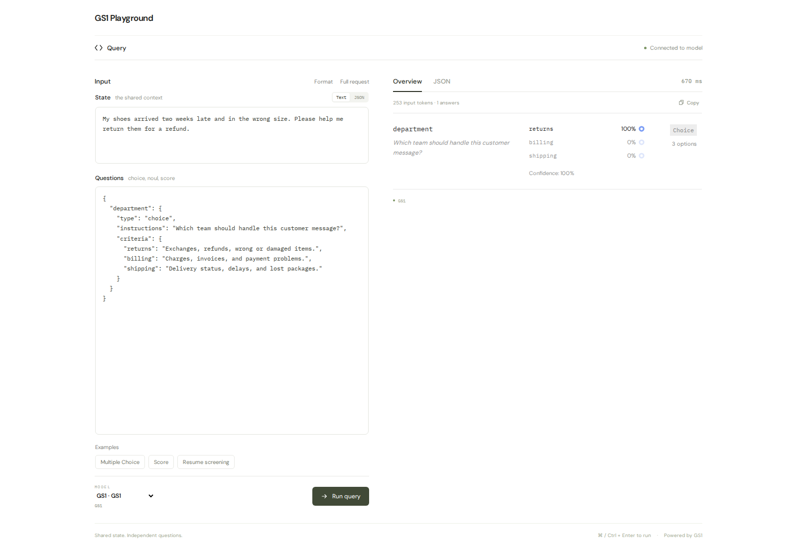

# GS1 Playground

[English](README.md) · [简体中文](README.zh-CN.md)

The React client and Node server expose **Query, Go, Maze and Snake** through the same typed-decision backend. GS1 is selected by default. Jev is available through the official TypeSafe API for comparison; no cloud key is needed for local GS1.



## Local GS1

```bash
# Repository root, terminal 1:
uv run gs1 serve --model /path/to/GS1-0.8B --model-name GS1

# Terminal 2:
cd playground
npm ci
npm run build
npm start
```

Open [localhost:3000](http://127.0.0.1:3000). `backends.yaml` points `gs1_local` at port 8000 and model alias `GS1`. Change its endpoint/model to match a deployed service. The service must expose `GET /v1/models` and `POST /v1/systemone`. The actual model identity comes from the configured endpoint, not a hard-coded size label.

## Optional Jev via TypeSafe

Get an API key from the [TypeSafe console](https://console.typesafe.ai). After installing dependencies and building as above, run from `playground/`:

```bash
export TYPESAFE_API_KEY="your-typesafe-api-key"
npm start -- --backends-config backends_jev.yaml --default-backend jev
```

Open [localhost:3000](http://127.0.0.1:3000) to use Jev without starting a local model server. The configured model is `jev-latest`; Node sends requests directly to `https://api.typesafe.ai/v1/systemone` with Bearer authentication, following the [official quick start](https://docs.typesafe.ai/introduction/quickstart). The key stays on the Node server.

To offer both GS1 and Jev, export the same variable and run `npm start` with the default catalog, then choose **Jev · TypeSafe** in the model selector.

## Development

```bash
# Separate terminals in playground/:
npm run dev:server
npm run dev
```

Vite on port 5173 proxies the Node API on port 3000. `npm start -- --host 127.0.0.1 --port 3000 --backends-config backends.yaml --default-backend gs1_local` sets the server options. Rebuild after frontend changes.

## Behavior

- **Query:** edit state plus mixed Choice/Noul/Score questions, or a full request. Structured fields round-trip intact. Overview shows provider probabilities; JSON retains the raw response. Cmd/Ctrl+Enter runs and Cancel aborts a pending request.
- **Go:** 5×5, 7×7 or 9×9; the model selects legal placements. The controller enforces captures, suicide prevention and positional superko. Completion requires every point to have settled ownership or neutral status. No pass or winner is manufactured.
- **Maze:** seeded perfect mazes; only unblocked adjacent moves are offered. The model selects each step. A 120-call run limit pauses without declaring success.
- **Snake:** raw board observations with one Choice and two Noul questions. The optional execution guard can override a proposed action; the UI/log records proposed and executed actions separately. Guarded outcomes are not presented as unaided model policy performance.

Run/Step/Pause controls preserve in-flight ownership and prevent stale responses from moving a game. Latency is the Node server's upstream round trip plus validation, excluding browser rendering. Raw Jev probabilities and its explicitly audited rounding normalization are retained separately from controller values.

## Validation

```bash
npm run typecheck
npm run test:server
npm run build
npm run test:e2e
```

Browser tests use fixtures; a live local GS1 check is separate. Source stays in this folder, generated `dist/`, logs and browser artifacts stay ignored.
