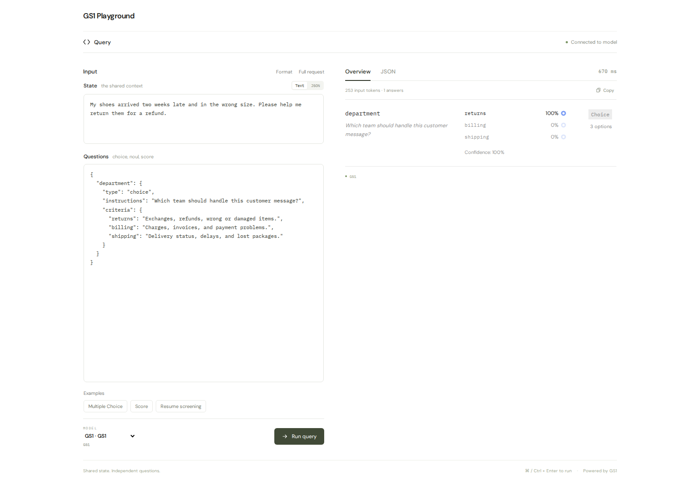

# GS1 Playground

[English](README.md) · [简体中文](README.zh-CN.md)

React 客户端与 Node 服务提供 **Query、Go、Maze、Snake**，共用类型化决策后端，默认选择 GS1。Jev 通过 TypeSafe 官方 API 提供可选对比，本地 GS1 无需云 API key。



## 本地 GS1

```bash
# 仓库根目录，终端 1：
uv run gs1 serve --model /path/to/GS1-0.8B --model-name GS1

# 终端 2：
cd playground
npm ci
npm run build
npm start
```

打开 [localhost:3000](http://127.0.0.1:3000)。`backends.yaml` 中 `gs1_local` 默认连接端口 8000、模型别名 `GS1`。可改为部署服务对应的地址和模型；服务应提供 `GET /v1/models` 与 `POST /v1/systemone`。展示名称来自配置的实际端点，不写死模型尺寸。

## 通过 TypeSafe 官方 API 使用 Jev

从 [TypeSafe 控制台](https://console.typesafe.ai)获取 API key，按上文安装依赖并构建后，在 `playground/` 中运行：

```bash
export TYPESAFE_API_KEY="your-typesafe-api-key"
npm start -- --backends-config backends_jev.yaml --default-backend jev
```

打开 [localhost:3000](http://127.0.0.1:3000) 即可使用 Jev，无需启动本地模型服务。默认模型为 `jev-latest`；Node 按[官方快速开始](https://docs.typesafe.ai/introduction/quickstart)，通过 Bearer 认证直接调用 `https://api.typesafe.ai/v1/systemone`。密钥仅保留在 Node 服务端。

如需同时提供 GS1 和 Jev，导出同一环境变量后，以默认配置运行 `npm start`，再从模型选择器切换到 **Jev · TypeSafe**。

## 开发

```bash
# 在 playground/ 的两个终端中分别运行：
npm run dev:server
npm run dev
```

端口 5173 的 Vite 将请求代理到端口 3000 的 Node 服务。`npm start -- --host 127.0.0.1 --port 3000 --backends-config backends.yaml --default-backend gs1_local` 可指定服务参数，前端修改后需重新构建。

## 行为

- **Query**：编辑状态与混合 Choice／Noul／Score，或完整请求。结构化字段不丢失；Overview 展示供应商概率，JSON 保留原始响应。Cmd／Ctrl+Enter 执行，Cancel 取消。
- **Go**：支持 5×5、7×7、9×9，由模型选择合法落子；控制器执行提子、自杀和位置超级劫检查，所有交叉点归属已确定或为中立时结束，不虚构 pass 或胜负。
- **Maze**：带种子的完美迷宫，仅提供相邻可通行方向，由模型逐步选择。120 次调用后暂停，不自动判定成功。
- **Snake**：提供原始棋盘，以一个 Choice、两个 Noul 决策。可选执行 guard 可能改写建议动作；界面和日志分别记录建议与执行，guarded 成绩不作为无辅助模型策略成绩。

Run／Step／Pause 保留正在执行请求的所有权，避免陈旧响应推动游戏。延迟为 Node 上游往返与校验，不含浏览器渲染。Jev 原始概率、明确审计的舍入归一化与控制器使用值分别保留。

## 验证

```bash
npm run typecheck
npm run test:server
npm run build
npm run test:e2e
```

浏览器测试使用 fixture，真实 GS1 联通另行检查。源码位于本目录；`dist/`、日志和浏览器产物保持忽略。
